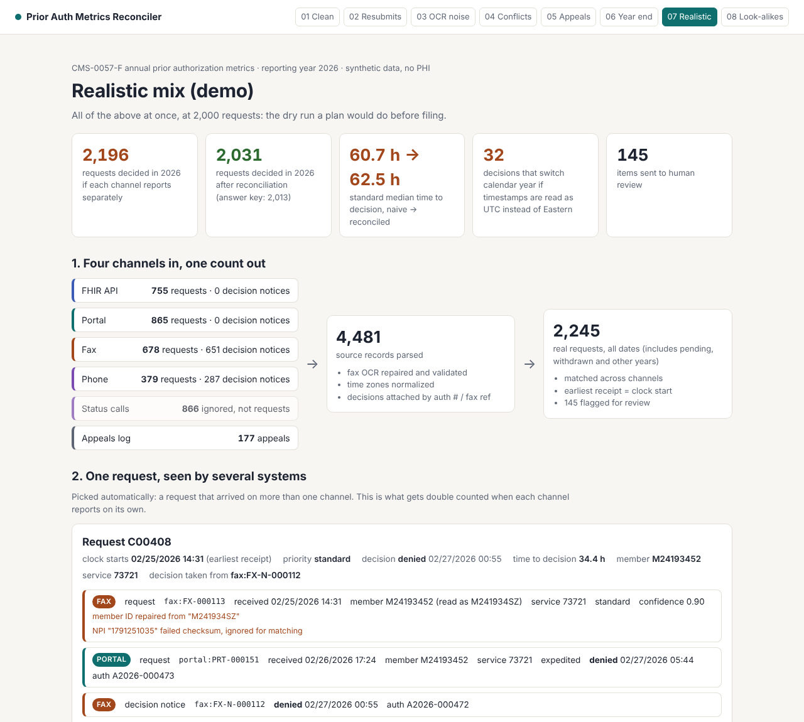

# Prior Auth Metrics Reconciler

**[Open the live demo](https://harshinireddy2204.github.io/prior-auth-metrics-reconciler/)** · no install needed

**One prior authorization request, four intake channels, one correct count.**

Under the CMS Interoperability and Prior Authorization Final Rule (CMS-0057-F), impacted health plans must publish prior authorization metrics every year: percent approved, percent denied, percent approved after appeal, mean and median time to decision for standard and expedited requests, and percent of requests with an extended review that were approved. The first report was due March 31, 2026. The next one covers calendar year 2026.

The metrics must cover every submission channel, not just the new FHIR API. In practice the same request often reaches a plan more than once: a clinic faxes a form, hears nothing, and resubmits on the portal, or calls. If each channel reports on its own, the plan double counts requests, starts the clock at the wrong time, and can file numbers that look better than reality.

This project reconciles those channels into one record per real request, computes the CMS metrics from it, and keeps a trail from every number back to the fax page, portal row, call or FHIR bundle behind it. Anything it cannot decide with confidence goes to a human review queue instead of being guessed.

Built in **TypeScript** (Node 20+), no database, no cloud, two runtime dependencies (the MCP SDK and zod). All data here is synthetic.



## What it does

```
FHIR PAS bundles ─┐
Portal export    ─┤   parse and validate     match records into      CMS-0057-F metrics
Fax OCR text     ─┼─► (OCR repair, NPI   ─►  real requests       ─►  with lineage, plus
Call center log  ─┤    checksum, time         (auth #, member,        a review queue
Appeals log      ─┘    zones)                 service, window)
```

1. **Parses each channel** into one shape. Fax pages are OCR text, so member IDs are repaired (`M1O29384B` becomes `M10293848`), NPIs are checked with their Luhn check digit, smudged service codes are recovered from the description, and every repair is written down. Status-check calls are recognized and never counted as requests.
2. **Attaches decisions** to the submission they answer (fax notices by fax reference, call relays and portal rows by authorization number).
3. **Matches submissions into requests**: same auth number, or same member (exact, or one keystroke off with the same birth date) and same service on a different channel within 21 days and before the decision. A request after a denial is a new request; a different doctor counts against a match.
4. **Builds each request**: the clock starts at the earliest receipt on any channel (CMS measures from payer receipt). The original submission is the system of record for priority and decision; any disagreement goes to review.
5. **Computes the metrics** three ways, side by side: naive (sum of channel reports), reconciled, and the answer key for synthetic data.
6. **Explains any number**: click a metric in the HTML report, or ask through the MCP server, and get the requests and source records behind it.

## Results on the eight test scenarios

Each scenario isolates one failure mode; `07-realistic` mixes all of them at 2,000 requests. "Key" is the answer key the generator writes alongside the data.

| Scenario | Requests decided: naive / reconciled / key | Std median hours: naive / reconciled / key | Merge precision | Merge recall | Review items |
|---|---|---|---|---|---|
| 01 Clean baseline | 302 / 302 / 302 | 57.2 / 57.2 / 57.2 | n/a | n/a | 0 |
| 02 Cross-channel resubmissions | 332 / 296 / 296 | 48.3 / 50.4 / 50.5 | 1.000 | 1.000 | 0 |
| 03 OCR and keying noise | 348 / 305 / 305 | 62.8 / 66.8 / 66.8 | 1.000 | 1.000 | 2 |
| 04 Channels disagree | 370 / 301 / 301 | 56.5 / 60.0 / 60.0 | 1.000 | 1.000 | 51 |
| 05 Appeals, extensions, look-alikes | 372 / 343 / 343 | 95.7 / 96.2 / 96.2 | 1.000 | 1.000 | 0 |
| 06 Year end and time zones | 249 / 232 / 232 | 60.0 / 71.7 / 71.7 | 1.000 | 1.000 | 0 |
| **07 Realistic mix** | **2,196 / 2,031 / 2,013** | **60.7 / 62.5 / 62.5** | **0.995** | **0.885** | **145** |
| 08 Look-alikes (hard) | 360 / 344 / 340 | 60.6 / 62.3 / 63.2 | 1.000 | 0.685 | 50 |

What this shows on the realistic mix:

- Adding up channel reports overstates requests decided in 2026 by **9.1%** (2,196 vs 2,013). Reconciled is off by 0.9% (18 requests), and those 18 are exactly the pairs sitting in the review queue as "possible duplicate".
- Naive counting makes the plan look **faster** than it is: each resubmission restarts the clock, so the standard median drops from 62.5 to 60.7 hours.
- **32 determinations** change calendar year if FHIR's UTC timestamps are mixed with Eastern wall-clock exports. In the year-end scenario the naive standard median is off by almost 12 hours.
- Merge precision is 99.5% (2 wrong merges in 2,245 requests). The tool prefers missing a merge over making a wrong one, because a wrong merge silently corrupts metrics while a missed one is visible in the review queue.

Scenario 08 is where rules alone run out: a second doctor ordering the same scan for the same patient looks almost exactly like a practice resubmitting under its group NPI. The tool does not guess; it counts them separately and flags them. That is the work a human (or a better data source, such as the provider directory) has to finish.

**An honest caveat.** I wrote both the data generator and the matcher, so these scores are an upper bound that shows the logic is sound, not a measurement on real payer data. Real exports will have failure modes this generator does not model.

## Quick start

```bash
npm install
npm test          # 36 tests: units, matching rules, all 8 scenarios end to end, MCP server
npm run demo      # generates every scenario and writes output/<scenario>/report.html
```

Open `output/07-realistic/report.html` in a browser. Step-by-step instructions for every feature are in **[docs/WALKTHROUGH.md](docs/WALKTHROUGH.md)**.

## Outputs per scenario

| File | What it is |
|---|---|
| `report.html` | The interactive report (single file, works offline) |
| `metrics.json` | Every metric, naive vs reconciled vs key, plus matching accuracy |
| `cases.csv` | One row per reconciled request with its source records; opens in Excel |
| `review_queue.csv` | Everything sent to a human, with the reason |

## Use it from an AI assistant (MCP)

`src/mcp/server.ts` is a Model Context Protocol server with five tools: `get_metrics`, `explain_metric`, `get_request`, `review_queue`, `list_scenarios`. Connect it to Claude Desktop or any MCP client and ask "why is the expedited denial rate 21.8%?" to get the answer with source records. Setup is in the walkthrough.

## Optional: local LLM for fax pages

Fax extraction runs on rules by default. With [Ollama](https://ollama.com) installed you can add a local model: `--fax hybrid` sends only the pages the rules could not read; `--fax llm` sends all of them. Whatever the model returns goes through the same checks (member ID shape, NPI checksum, code shape), so a confident wrong answer is still caught. A local model keeps PHI on the machine. The LLM path is tested against a mocked Ollama response; it has not yet been benchmarked against a real model.

## Project layout

```
src/
  ingest/      one parser per channel (fhir, portal, fax + faxLlm, phone, appeals)
  match/       reconciliation rules and review queue
  metrics/     CMS-0057-F metric definitions; naive / reconciled / truth views
  synth/       scenario definitions and the synthetic data generator
  eval/        scores matching against the answer key
  report/      HTML report
  mcp/         MCP server
  cli.ts       command line
test/          unit, matching, scenario and MCP tests
data/scenarios/<name>/   generated inputs + truth.json (answer key, never read by the reconciler)
output/<name>/           generated outputs
```

## Assumptions to confirm with a plan's compliance team

- A request is counted in the calendar year of its determination, in the plan's time zone (`--basis receipt` switches to receipt date).
- Withdrawn requests and requests without a determination are excluded and reported separately; CMS's template does not address withdrawals.
- The FHIR input is shaped like Da Vinci PAS (`Claim` with `use = preauthorization`, `ClaimResponse` with the X12 review action code) but is not validated against the implementation guide.
- Metrics are aggregated across all items and services, which is how the CMS template asks for them; per line of business or contract reporting would run the tool once per line.

## Sources

- [CMS fact sheet: CMS-0057-F](https://www.cms.gov/files/document/fact-sheet-cms-interoperability-and-prior-authorization-final-rule-cms-0057-f.pdf)
- [CMS Prior Authorization Metrics Reporting Overview template](https://www.cms.gov/files/document/prior-authorization-metrics-reporting-overview-template.pdf)
- [1upHealth: Q&A from the CMS-0057 in Action webinar](https://1up.health/blog/qa-from-the-cms-0057-in-action-webinar/) (combining metrics across non-FHIR channels; validating incoming data)

## License

MIT
